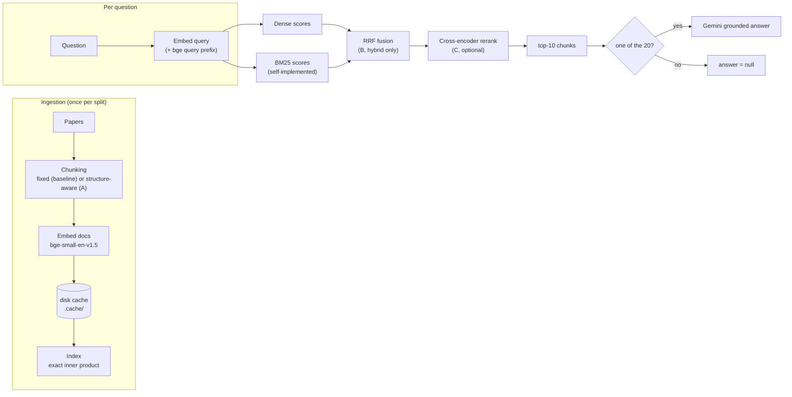
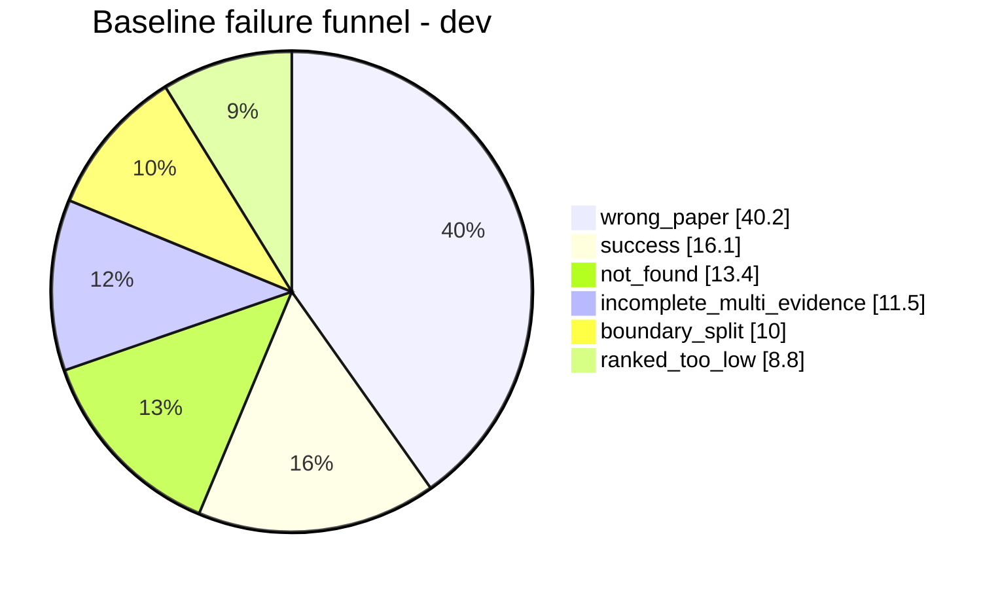

# GUIDE — What this project does, and why

This guide walks through the whole retrieval pipeline in plain language: what the
assignment asked for, how a question flows through the system, what went wrong in
the baseline, which optimizations were chosen and why, and what the final numbers
mean. It also states honestly what was *planned but not built* (IVF, HNSW, and the
rest of the "extended bank").

`README.md` is the short reference (setup, commands, tables). This file is the
explanation.

---

## 1. The assignment in one paragraph

Build a **naive RAG retriever** for QASPER, **inspect 10 failures**, **test three
independent optimizations**, and **show which changes help**. Search must cover
*all* papers in a split — never filter to the target paper — and only evidence from
the target paper counts as correct. Answers are generated for only **20 fixed
held-out questions**; everything else is retrieval-only.

The controlling idea is **retrieval-first, measure-don't-assume**: every change is
judged by gold-evidence recall, not vibes, and every gain is reported next to its
cost (latency, LLM calls).

---

## 2. The big picture: how a question flows through the system



Key point: **ingestion happens once per split**, then every question only needs a
query embedding (and, for hybrid, a BM25 scoring pass). That is why document
embeddings are cached to disk — rerunning an experiment reuses them instead of
re-embedding thousands of chunks.

---

## 3. Data and fixed setup

| Thing | Value | Why it matters |
|---|---|---|
| Dataset | QASPER validation split (pinned HF revision) | Everyone uses identical text |
| Split | 80 dev + 50 held-out papers, `seed 42` | Dev is for tuning, held-out for one final check |
| Questions | 295 dev / 182 held-out | All questions of each split |
| Answer subset | 20 qids sampled from held-out (`seed 42`) | Only these get an LLM answer |
| Embedding | `BAAI/bge-small-en-v1.5` | Bi-encoder, instruction-tuned |
| Generator | `gemini-3.5-flash-lite`, temperature 0 | Cheap, deterministic |

The split is fixed and reproducible (same `sorted → shuffle → slice` as the brief).
Because dev and held-out are disjoint, tuning on dev cannot leak into the held-out
score.

### Gold evidence and the coverage rule

Each QASPER question lists *evidence* spans from the target paper. Those are mapped
back to paragraph IDs (`abstract`, `s0:p4`, …). A retrieved chunk "covers" a gold
paragraph when its `source_spans` contain **at least 80% of the paragraph's word
tokens**.

```text
coverage(paragraph) = covered_tokens / total_tokens  >=  0.8
```

Two readings of "80% of tokens" are implemented and both reported:

- **Union** — merge the spans of all top-k chunks together, then check 80%.
- **Single** — one chunk alone must cover 80%.

The brief does not say which is meant, so the results keep both. The headline
numbers use **union**.

> **Exclusion note:** some questions only have figure/table evidence (the
> `FLOAT SELECTED …` strings), which has no paragraph ID and therefore no tokens to
> measure. Those questions are excluded from Recall/MRR: 261 of 295 dev and 155 of
> 182 held-out questions have paragraph-level gold. They are still present in the
> JSONL files.

---

## 4. The pipeline stages, and the theory behind each

### 4.1 Chunking — the baseline and optimization A

The **baseline** cuts each paper's concatenated text into overlapping fixed windows
(1,000 chars, 200 overlap). Simple, but it ignores document structure.

**What goes wrong (the theory).** A gold paragraph can be split across two windows,
so no single chunk reaches 80% coverage ("boundary split"). Fixed windows also mix
an unrelated heading into a chunk, and a query against *all* papers can confuse two
papers that discuss the same topic.

**Optimization A (structure-aware chunking).** Units are paragraphs; short
paragraphs in the same section merge up to ~1,000 chars, long ones split at
sentence boundaries, and chunks never cross section boundaries. The **embedded**
text is `title | section heading + chunk` while the **returned** text stays the
original paragraph (so `source_spans` remain exact). This fixes boundary splits and
gives the encoder a disambiguating title/heading signal.

### 4.2 Embedding — a bi-encoder with a query prefix

`bge-small-en-v1.5` maps text to a normalized vector; inner product on normalized
vectors equals cosine similarity. Because it is instruction-tuned, queries must be
prefixed with the instruction (`Represent this sentence for searching relevant
passages: `) while passages are embedded raw. That prefix is *correct model usage*,
not an optimization.

Document embeddings are cached to `.cache/` keyed by content hash, so unchanged
chunks are never re-embedded. This is the "cache document/query embeddings" the
brief explicitly requires.

### 4.3 Retrieval — dense, BM25, and the hybrid (optimization B)

- **Dense** is a *bi-encoder*: query and document are encoded independently, so all
  document vectors can be precomputed and the query is just one matrix multiply. It
  captures **semantic** similarity but misses rare exact terms (dataset names,
  `BERTbase`, `Elasticsearch`).
- **BM25** is *lexical*: it ranks by exact word overlap. Implemented from scratch
  (`bm25.py`): lowercase alphanumeric tokenization, a stopword list, an inverted
  index of postings, document frequency → IDF, and Okapi scoring
  `idf = ln(1 + (N − df + 0.5)/(df + 0.5))`, `k1 = 1.2`, `b = 0.75`. It rewards rare
  terms and saturates term frequency, but has no notion of meaning.
- **Hybrid (optimization B)** fuses the two with **Reciprocal Rank Fusion**:
  `score = Σ 1/(k + rank)`, `k = 60`. RRF needs no score calibration because it
  only cares about ranks, and it is robust when the two rankers disagree.

Dense and lexical are complementary: dense handles paraphrase, BM25 handles exact
rare tokens. This is why hybrid helps the "wrong paper" and "not found" failures.

### 4.4 Reranking — a cross-encoder (optimization C)

Dense is a bi-encoder, so the query and document never "see" each other in the same
model. A **cross-encoder** concatenates `[query, doc]` and attends jointly, so it
can judge exact relevance — at the cost of having to run the model on every
candidate pair (no precomputation). It is therefore used only to **reorder the
top-30 candidates** (`cross-encoder/ms-marco-MiniLM-L-6-v2`, truncated at 512
tokens). This fixes "ranked too low" cases: the right chunk is already in the pool,
just ranked badly.

### 4.5 Generation — grounded, and only for 20 questions

For the 20 fixed questions, the top-10 chunks are numbered `[1]–[10]` and fed to a
single grounded prompt that says "answer only from the context, or abstain", with a
JSON reply `{"answer", "abstained"}`. Temperature 0, so any difference between
baseline and final is caused by *retrieval*, not sampling. Responses are cached on
disk.

---

## 5. Diagnosis: how the failures were found

Every dev question with gold evidence gets exactly one label from a priority-ordered
decision tree (`analysis/funnel.py`):

| # | Label | Meaning |
|---|---|---|
| 1 | `wrong_paper` | no top-10 chunk is from the target paper |
| 2 | `incomplete_multi_evidence` | some but not all gold paragraphs covered |
| 3 | `boundary_split` | right paper, but chunk edges cut the paragraph (<80%) |
| 4 | `ranked_too_low` | gold covered in top-50 but not top-10 |
| 5 | `not_found` | target paper present, gold not even in top-50 |
| — | `success` | all gold paragraphs covered in top-10 |

The baseline funnel (dev, 261 questions):



### Headroom: how much was actually recoverable

Two diagnostics bound what any optimization *could* achieve:

```text
Paper-confusion diagnostic   : 0.212 -> 0.651   union R@10
  (restrict search to the target paper; diagnostic only, never submitted)
Chunking ceiling             : 1.00 union / 0.69 single  R@10
  (a perfect ranker over the baseline chunks)
```

The big number is **40.2% wrong_paper** — the dominant failure. The
paper-restricted diagnostic (0.651) shows most of the loss is *retrieving from the
wrong paper*, not a chunking problem. This directly motivated A (title/heading
context to disambiguate papers) and B (BM25 to match distinctive terms).

The full 10-case table with question IDs, causes, and fixes is in
[`results/failure_table.md`](results/failure_table.md).

---

## 6. Why A, B, and C

Each optimization targets the specific failures above:

| Failure (share) | Chosen optimization | Stage | Theory |
|---|---|---|---|
| wrong_paper (40.2%) | **A** structure + title/section context, **B** BM25 hybrid | ingestion + retrieval | disambiguate papers by context; match rare exact terms |
| boundary_split (10.0%) | **A** structure-aware chunking | ingestion | snap chunk edges to paragraph/section boundaries |
| ranked_too_low (8.8%) | **C** cross-encoder rerank | selection/ranking | joint query-doc attention reorders the pool |
| not_found (13.4%) | **B** BM25 lexical retrieval | retrieval | exact rare tokens that dense embeddings dilute |
| incomplete_multi (11.5%) | **A** + **C** | ingestion + ranking | keep facets intact, surface more than one gold paragraph |

Three changes, three stages (ingestion, retrieval, ranking) — satisfying the brief's
"at least 3 meaningful changes across at least 2 stages".

---

## 7. Results in detail

### 7.1 Independent ablation (dev, 261 questions, union coverage)

| Configuration | R@5 | R@10 | MRR@10 | Median retrieval latency | LLM calls/q |
|---|---:|---:|---:|---:|---:|
| Baseline (fixed + dense) | 0.153 | 0.212 | 0.124 | 13 ms | 0 |
| + A (structure + context) | 0.195 | 0.287 | 0.146 | 14 ms | 0 |
| + B (dense + BM25, RRF) | 0.161 | 0.255 | 0.141 | 386 ms | 0 |
| + C (cross-encoder top-30) | 0.191 | 0.247 | 0.151 | 4,386 ms | 0 |
| Final (A + B + C) | 0.246 | 0.354 | 0.230 | 5,027 ms | 0 |

Reading the table:

- **A alone** is the biggest single win (+0.075 R@10) and nearly free.
- **B alone** helps a little (+0.043) but costs ~30x the latency (BM25 pass).
- **C alone** improves ordering (+0.027 MRR) but is the most expensive.
- **Final** wins on all three metrics: **+0.142 R@10, +0.106 MRR@10** over baseline.

### 7.2 Development vs held-out (union and single)

| Split | Config | Coverage | R@5 | R@10 | MRR@10 |
|---|---|---|---:|---:|---:|
| Dev | Baseline | Union | 0.153 | 0.212 | 0.124 |
| Dev | Final | Union | 0.246 | 0.354 | 0.230 |
| Dev | Baseline | Single | 0.128 | 0.174 | 0.111 |
| Dev | Final | Single | 0.238 | 0.345 | 0.227 |
| Held-out | Baseline | Union | 0.169 | 0.234 | 0.140 |
| Held-out | Final | Union | 0.259 | 0.339 | 0.221 |
| Held-out | Baseline | Single | 0.158 | 0.212 | 0.135 |
| Held-out | Final | Single | 0.247 | 0.310 | 0.216 |

The final gains **transfer to held-out** (union R@10 +0.105, MRR +0.081), slightly
smaller than on dev — what you want to see, since held-out was never tuned.

### 7.3 Answer generation (20 held-out questions)

| System | Answer F1 (all 20) | Answer F1 (19 answerable) | Abstained | Gold-unanswerable | False-answer rate |
|---|---:|---:|---:|---:|---:|
| Baseline | 0.157 | 0.113 | 9/20 | 1 | 0.0 (n=1) |
| Final | 0.203 | 0.161 | 9/20 | 1 | 0.0 (n=1) |

Normalized answer F1 = SQuAD-style token F1 (lowercase, strip punctuation and
articles, max over annotators). The sample contains **1** gold-unanswerable
question; both systems correctly abstained on it, so the false-answer rate is 0.0
but is *exploratory* (n=1). Both systems answer 11 and abstain 9; the final's
answers score higher. The sample is far too small for a conclusive answer claim.

### 7.4 Latency and cost

| Scope | Baseline | Final |
|---|---:|---:|
| Retrieval median (dev) | 13 ms | 5,027 ms |
| Retrieval median (held-out) | 14 ms | 5,350 ms |
| Retrieval + generation median (20 qs) | 5,239 ms | 10,770 ms |
| LLM calls (held-out total) | 20 | 20 |

The cross-encoder dominates the final's cost (~5 s/query vs 13 ms). All 182 held-out
questions incur retrieval; only the 20 selected incur an LLM call (1 each).

---

## 8. Planned but not built (honest scope statement)

The original plan ("experiment bank") included more than was delivered. This is what
was **actually implemented vs. only planned**:

```text
implemented & measured          planned but NOT built
--------------------------      --------------------------------------------
chunk  structure-aware (A)      mmr     MMR + overlap dedup
hybrid dense + BM25 + RRF (B)   hyde    HyDE (LLM-generated query)
rerank cross-encoder (C)        multiq  multi-query / step-back
flat   exact inner product      ctx     LLM contextual chunk enrichment
                                s2b     small-to-big retrieval
                                ann     IVF / HNSW approximate indexes
```

**IVF and HNSW were never implemented or tested.** Only the exact `FlatIPIndex`
(NumPy inner product) exists; there is no FAISS/hnswlib dependency. The same is true
for MMR, HyDE, multi-query, contextual enrichment, and small-to-big — they appear
only as planned rows in `decisions.md` (under "Extended bank") and as suggested-fix
strings in `scripts/failure_cases.py`.

**The reason:** the plan itself set a "cut line" — finish the *minimum complete
submission* first (baseline + A/B/C + the seven JSONL files + the required tables),
then add the extended bank "if time permits". Time ran out, so the minimum
submission was completed and validated first, and the extended bank was left as
future work.

For IVF/HNSW in particular there is a second, substantive reason they were
deprioritized: the corpus is only a few thousand chunks, so exact search is already
microseconds and the query-embedding / model inference dominates latency. An
approximate index would therefore give ~0 accuracy gain at this scale — which the
plan anticipated with its planned "scale test" on synthetic 10x/100x corpora. So the
brief's core requirement ("3 meaningful changes across ≥2 stages") is fully met by
A/B/C, and the ANN work was consciously skipped, not lost.

---

## 9. Reflection

**What worked.** Structure-aware chunking (A) was the single largest win — it fixed
boundary splits and, via title/section context, reduced paper confusion (the 40.2%
dominant failure). Self-implemented BM25 fused with dense (B) added lexical recall
for rare terms. Cross-encoder reranking (C) fixed "ranked too low" cases. Together
they lift union R@10 from 0.212 to 0.354 on dev, and 0.234 to 0.339 on held-out.

**What did not help.** B alone is marginal (+0.043 R@10) at ~30x latency; C alone
improves ordering but barely recall. Non-selected ablations (BM25-only,
structure-without-context, rerank pool 50 vs 30) did not beat the final settings.

**Quality vs cost.** The final system is ~380x slower per query (5.0 s vs 13 ms)
because of the cross-encoder. For an offline, retrieval-first task that is an
acceptable trade for +0.142 R@10. In a latency-sensitive setting, structure chunking
+ hybrid *without* reranking (+~0.11 R@10 at ~386 ms) is the cheaper option. LLM
cost stays minimal by design: answers for only 20 questions, one call each.

---

## 10. Code map — which file does what

| File | Role |
|---|---|
| `src/ragopt/data.py` | load QASPER, fixed 80/50 split, gold-evidence → paragraph mapping |
| `src/ragopt/chunking/fixed.py` | baseline overlapping fixed-window chunks |
| `src/ragopt/chunking/structure.py` | structure-aware chunks + title/section context (A) |
| `src/ragopt/embed.py` | `bge-small` wrapper, query prefix, disk cache |
| `src/ragopt/dense.py` | exact inner-product index (`FlatIPIndex`) |
| `src/ragopt/bm25.py` | BM25 from scratch (tokenizer, IDF, Okapi scoring) |
| `src/ragopt/fusion.py` | reciprocal rank fusion |
| `src/ragopt/rerank.py` | cross-encoder reranking (C) |
| `src/ragopt/pipeline.py` | `Config` → build chunks → retrieve (every experiment is a config) |
| `src/ragopt/metrics.py` | Recall@k, MRR@10, 80% coverage (union + single) |
| `src/ragopt/analysis/funnel.py` | failure classification |
| `src/ragopt/headroom.py` | chunking ceiling / oracle ranking |
| `scripts/run_experiment.py` | run one config, save per-question results |
| `scripts/export_jsonl.py` | write the JSONL outputs in the task format |
| `scripts/answer20.py` | generate the 20 grounded answers |
| `scripts/score_answers.py` | recompute retrieval + answer metrics from JSONL |
| `scripts/validate.py` | JSONL format checker |
| `results/failure_table.md` | the 10-question failure table |
| `decisions.md` | pre-registration decision log |

Reproduce a config with, for example:
`python scripts\run_experiment.py --name struct_ctx_hybrid --chunker structure --context --retriever hybrid`.
