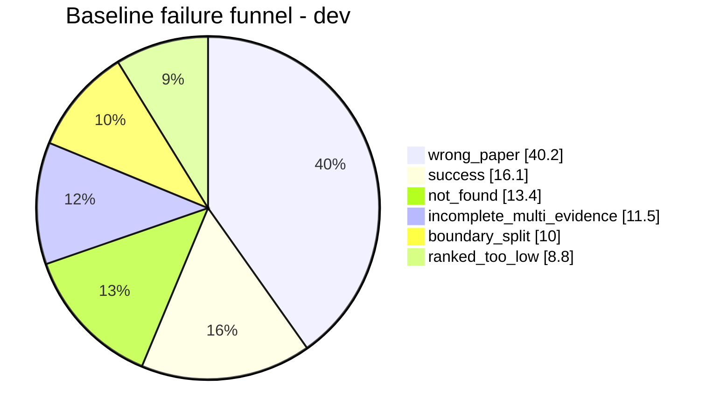
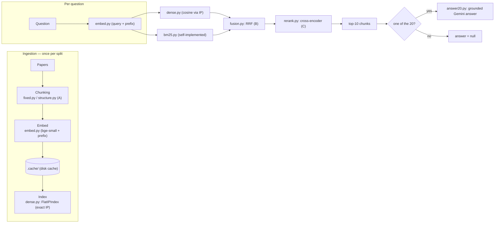
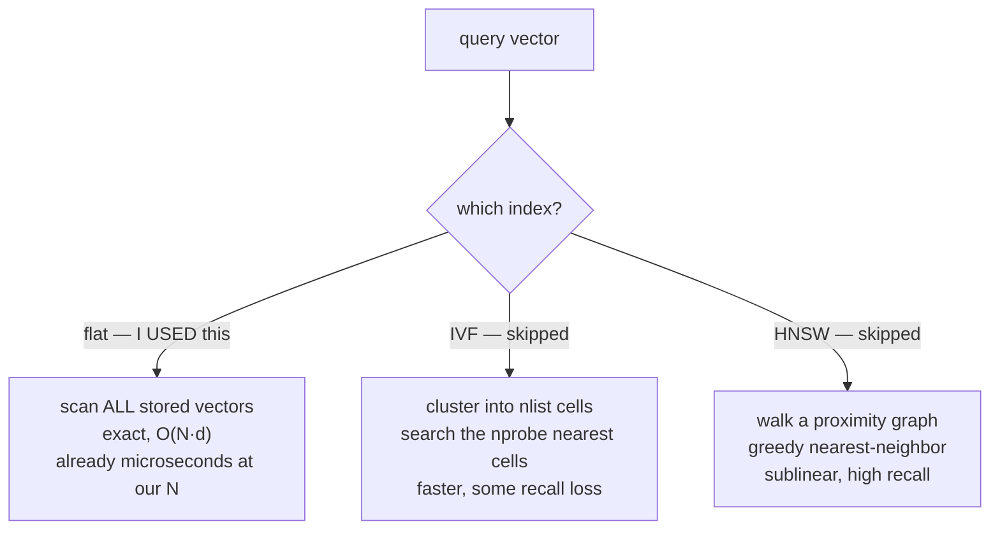

# PRESENTATION — RAG Optimization (companion notes)

This file is your **presentation script**. It is written so you can speak from it
confidently: each section states the idea in plain English, maps it to the exact
file and algorithm in this repo, and gives you the numbers to back the claim.

Two other files complement this one:

- `README.md` — the short reference (setup, commands, results tables).
- `GUIDE.md` — the same story written as documentation.

---

## 0. The 30-second version (say this first)

> "I built a **simple RAG retriever** for QASPER, found out **why it failed**, tested
> **three changes** across three stages, and showed which ones actually help. The key
> result: the final system lifts retrieval recall from **21.2% to 35.4%** on the
> development split, and from **23.4% to 33.9%** on held-out — measured with real gold
> evidence, not vibes. Every gain is shown next to its cost in time and LLM calls."

The rule behind the whole task is **fix retrieval first, and measure everything**: a
fluent answer means nothing if the right evidence never reached the model.

---

## 1. The assignment, in my own words

- **Input:** the QASPER validation split — **80 development papers** (for tuning) and
  **50 held-out papers** (for one final check), with **all** their questions.
- **Retrieval:** each question searches **all papers in its split** (never filtered
  to the target paper). Only evidence from the *target* paper counts as correct.
- **Baseline:** overlapping fixed-length character chunks + dense similarity + top-10.
- **Three optimizations** (`A`, `B`, `C`), chosen **from diagnosed failures**, tested
  one at a time, then combined into a final system.
- **Answers:** generated for only **20 fixed held-out questions** (seed 42). Everything
  else is retrieval-only (`answer: null`).

The whole thing is reproducible because of one line: **`seed 42`**.

```text
            prepare ──▶ chunk ──▶ embed & index ──▶ retrieve ──▶ refine ──▶ answer
(ingestion)              (A)          (fixed)         (B: hybrid)   (C: rerank)  (20 qs only)
```

---

## 2. The central question I answer

> **If a response is wrong, did the system fail to *find* the evidence, *choose* the
> right evidence, or *use* the evidence it already had?**

My answer, measured on 261 dev questions, is mostly **"it found the wrong paper."**
The failure funnel says **40.2%** of failures are `wrong_paper` — the target paper
never even appears in the top-10. That single number drives the choice of A, B and C.



---

## 3. The pipeline, mapped to the actual code



**Key design idea — "one pipeline, many switches."** Every experiment is a `Config`
dataclass in `pipeline.py` (`chunker`, `retriever`, `rerank_pool`, …), never a code
fork. So "baseline", "A", "B", "C", and "final" are the *same code* with different
flags — which is exactly the "reproducible switches" the brief asks for.

---

## 4. Stage by stage: the concept, my algorithm, and the file

### 4.1 Prepare the evidence — chunking (field-guide §02)

**The concept.** Chunking decides what one search result can explain *by itself*.
Fixed windows are simple, but they can cut a paragraph in half — separating a method
from its result. Structure-aware chunking follows headings, paragraphs and sections
instead.

**What I built.**

- **Baseline** — `src/ragopt/chunking/fixed.py`: overlapping fixed windows of
  **1,000 characters** with **200 overlap**, sliding over the concatenated paper.
  Each chunk records exact `source_spans` back into the original paragraphs (so
  nothing is ever "lost" to the grader).
- **Optimization A** — `src/ragopt/chunking/structure.py`:
  - units are **paragraphs**; short paragraphs in the same section merge up to
    1,000 chars (`merge_below=300`);
  - long paragraphs split at **sentence boundaries**, never mid-sentence;
  - chunks **never cross a section boundary** (the abstract is its own section);
  - when `context=True`, the **embedded** text becomes `title | section heading + chunk`
    while the **returned** text stays the original paragraph (so spans stay exact).

**Why A works.** Two effects: (1) *boundary snapping* keeps a gold paragraph inside one
chunk, so it can reach the 80% coverage rule; (2) the title and heading give the model
a signal to **tell papers apart** when they talk about the same topic — this attacks the
40.2% `wrong_paper` problem directly.

**Numbers to say:** A alone lifts R@10 from 0.212 → **0.287** at nearly zero cost
(14 ms vs 13 ms).

### 4.2 Embed and organize — represent the text as vectors (§04)

**The concept.** An *embedding model* turns text into a vector; an *index* makes search
over many vectors fast. The two must not be mixed up. "A dictionary looks up a key you
already know; a vector index finds *similar* vectors without knowing the ID first."

**What I built** — `src/ragopt/embed.py`:

- model `BAAI/bge-small-en-v1.5`, **L2-normalized** so inner product = cosine;
- queries get the instruction prefix
  `"Represent this sentence for searching relevant passages: "` (that is *correct
  model usage*, not an optimization);
- document and query embeddings are **cached to disk** (`.cache/emb_*.npz`) keyed by a
  SHA-1 of the text, so reruns never re-embed unchanged chunks — the "cache
  embeddings" requirement in the brief.

**Index** — `src/ragopt/dense.py`: a **flat exact index** (`FlatIPIndex`) — one
matrix multiply `query @ documentsᵀ`, top-k via `np.argpartition`.

> I chose **exact** search on purpose, not IVF/HNSW. At a few thousand chunks, exact
> search already takes microseconds; the query embedding and the model call dominate the
> time, so an approximate index would risk losing good results for almost no gain.
> (See §9.)

### 4.3 Retrieve — dense, and the hybrid with BM25 (§05)

**The concept.** Dense search captures *meaning* ("prevent overfitting" ↔
"regularization through dropout"). BM25 matches *exact words* (names, error codes,
dataset names). Neither is always stronger.

**What I built — `src/ragopt/bm25.py`, from scratch** (the brief forbids `rank_bm25`):

1. `tokenize`: lowercase, alphanumeric tokens, a stopword list.
2. `fit`: builds an **inverted index** (term → postings with term frequency), plus
   document lengths and average length.
3. `scores`: Okapi BM25 with **k1 = 1.2, b = 0.75**, IDF
   `idf = ln(1 + (N − df + 0.5)/(df + 0.5))`, and length normalization
   `tf·(k1+1) / (tf + k1·(1 − b + b·dl/avgdl))`.

**Fusion — `src/ragopt/fusion.py`:** **Reciprocal Rank Fusion**,
`score(d) = Σ 1/(k + rank(d))`, `k = 60`. RRF needs no score calibration because it
only reads *ranks*, which is exactly why two incomparable score scales (cosine vs
BM25) can be merged.

**Why B works.** Dense search misses rare exact words (`BERTbase`, `Elasticsearch`,
dataset names). BM25 catches them but can't match paraphrases. Hybrid = two different
"instincts". B alone: R@10 0.212 → **0.255** (cost: ~386 ms because of the BM25 pass).

### 4.4 Refine / choose candidates — cross-encoder reranking (§07)

**The concept.** *Nearest is not most useful.* A bi-encoder turns query and document
into vectors separately, so they never "see" each other. A **cross-encoder** puts
`[query, doc]` together and reads them at the same time → much sharper relevance, but
you can't precompute it.

**What I built — `src/ragopt/rerank.py`:** `cross-encoder/ms-marco-MiniLM-L-6-v2`
(truncated at 512 tokens), applied **only to reorder the top-30 candidates**. This is
cheap enough to be practical and precisely fixes the "right chunk, wrong rank"
failure (`ranked_too_low`).

**Why C works.** The right passage is already in the candidate pool; the cross-encoder
just lifts it into the top-10. C alone: R@10 0.212 → **0.247**, but MRR improves the
most (+0.027), and it is the most expensive (~4.4 s/query).

### 4.5 Use the evidence — grounded generation (§08)

**The concept.** Retrieval isn't enough if the model ignores the passages or invents
claims. Grounded prompting labels each source and lets the model refuse to answer.

**What I built — `scripts/answer20.py`:** for the 20 questions, chunks are numbered
`[1]–[10]` in rank order, one prompt says "answer only from the context, or
abstain", returns JSON `{"answer", "abstained"}`, **temperature 0** (so baseline vs
final differ only because of retrieval), responses cached on disk.

---

## 5. Diagnosis — how I *found* the failures (§01 + §09)

`src/ragopt/analysis/funnel.py` gives every dev question exactly one label, using a
priority-ordered decision tree:

| Priority | Label | Meaning |
|---|---|---|
| 1 | `wrong_paper` | no top-10 chunk is from the target paper |
| 2 | `incomplete_multi_evidence` | some (not all) gold paragraphs covered |
| 3 | `boundary_split` | right paper, but chunk edges cut the paragraph (<80%) |
| 4 | `ranked_too_low` | gold covered in top-50, not top-10 |
| 5 | `not_found` | target paper present, gold not even in top-50 |
| — | `success` | all gold paragraphs covered in top-10 |

Two **headroom** diagnostics bound what any optimization could achieve
(`src/ragopt/headroom.py`):

```text
paper-confusion diagnostic : union R@10 0.212 -> 0.651
   (restrict search to the target paper; DIAGNOSTIC ONLY, never submitted)
chunking ceiling          : 1.00 union / 0.69 single  (a perfect ranker)
```

The takeaway I present: the ceiling is high (1.00), so the *chunks* are fine; the loss
is **retrieval** — mostly picking the wrong paper. That's why A and B target telling
papers apart and exact-word matching, not a bigger model.

The full 10-case table (question ID → problem → cause → fix) is
[`results/failure_table.md`](results/failure_table.md).

---

## 6. Evaluation — exactly how comparison is done (§09)

The metric is **gold-evidence coverage**, defined in `src/ragopt/metrics.py`:

```text
A gold paragraph is "covered" when the retrieved source spans contain
   >= 80% of its word tokens.

Recall@k   = covered gold paragraphs / all gold paragraphs  (top-k)
MRR@10     = 1 / (first rank at which ANY gold paragraph is covered)
```

Two readings of "80% of tokens" are implemented behind a switch, and **both** are
reported because the brief is ambiguous:

- **union** — merge the spans of all top-k chunks, then check 80%.
- **single** — one chunk alone must cover 80%.

```text
Baseline chunk [....X....] [....X....]      union: X+X covers the paragraph  -> covered
Single: neither half reaches 80%            -> not covered
```

Questions with no paragraph-level gold (figure/table-only evidence, or unanswerable
questions with no paragraph ID) are excluded: **261 of 295 dev** and **155 of 182
held-out** questions have paragraph gold. This is stated openly, not hidden.

Answers (the 20) are scored in `scripts/score_answers.py` with **normalized answer F1**
(lowercase, strip punctuation + articles, token F1, max over annotators) and a
**false-answer rate** = non-abstained answers on gold-unanswerable questions.

---

## 7. Results — the tables I present

### 7.1 The required ablation table (dev, union coverage)

| Configuration | R@5 | R@10 | MRR@10 | Median retrieval latency | LLM calls/q |
|---|---:|---:|---:|---:|---:|
| Baseline (fixed + dense) | 0.153 | 0.212 | 0.124 | 13 ms | 0 |
| + A (structure + context) | 0.195 | 0.287 | 0.146 | 14 ms | 0 |
| + B (dense + BM25, RRF) | 0.161 | 0.255 | 0.141 | 386 ms | 0 |
| + C (cross-encoder top-30) | 0.191 | 0.247 | 0.151 | 4,386 ms | 0 |
| **Final (A + B + C)** | **0.246** | **0.354** | **0.230** | 5,027 ms | 0 |

**How to read it aloud:** "A is the biggest win and nearly free; B helps a little but
costs 30× more time; C helps ranking but is expensive. All three together win on every
measure — **+0.142 recall and +0.106 MRR** over baseline."

### 7.2 Development vs held-out (the honest check)

| Split | Config | Coverage | R@5 | R@10 | MRR@10 |
|---|---|---|---:|---:|---:|
| Dev | Baseline | Union | 0.153 | 0.212 | 0.124 |
| Dev | Final | Union | 0.246 | 0.354 | 0.230 |
| Held-out | Baseline | Union | 0.169 | 0.234 | 0.140 |
| Held-out | Final | Union | 0.259 | 0.339 | 0.221 |

"The gains **transfer to held-out** (+0.105 recall), which is what you want because
held-out was never used for tuning."

### 7.3 Answers (20 questions) and cost

| System | Answer F1 (all 20) | Abstained | Gold-unanswerable | False-answer rate |
|---|---:|---:|---:|---:|
| Baseline | 0.157 | 9/20 | 1 | 0.0 (n=1) |
| Final | 0.203 | 9/20 | 1 | 0.0 (n=1) |

| Scope | Baseline | Final |
|---|---:|---:|
| Retrieval median (dev) | 13 ms | 5,027 ms |
| Retrieval + generation median (20 qs) | 5,239 ms | 10,770 ms |
| LLM calls (held-out total) | 20 | 20 |

---

## 8. A concrete demo (before / after)

This is the demo to show live. It is one of **36 questions** where the baseline
failed and the final system succeeded.

> **Question:** *"How are models evaluated in this human-machine communication game?"*
> **Target paper:** *Learning Autocomplete Systems as a Communication Game*
> **Gold evidence:** *"We evaluate our approach by training an autocomplete system on
> 500K randomly sampled sentences from Yelp reviews…"*

```text
BASELINE (dense only)
  top-1 -> "Neural User Simulation for Corpus-based Policy Optimisation"   ✗ wrong paper
  gold paragraph: not covered  -> R@10 = 0  (this question fails)

FINAL (structure + hybrid + rerank)
  top-1 -> "Learning Autocomplete Systems as a Communication Game"        ✓ target paper
  gold paragraph: covered      -> R@10 = 1  (this question succeeds)
```

**Why it flipped:** the baseline's dense embedding ranked a similar-sounding paper about
"user simulation / communication" above the real one. The final's title/heading context
(A) + BM25 matching on exact distinctive words (B) + the cross-encoder (C) pulled the
target paper up to rank 1.

A live demo you can run (in the repo):

```powershell
.\.venv\Scripts\Activate.ps1
python scripts\score_answers.py results\dev_baseline.jsonl results\dev_final.jsonl
python scripts\validate.py results\dev_*.jsonl results\heldout_*.jsonl
```

---

## 9. The initial plan — and what I scoped out (and why)

The brief needs "at least 3 meaningful changes across ≥2 stages"; A/B/C deliver that.
But my *original* plan (logged in `decisions.md` as the "experiment bank") was larger.
This section explains each unbuilt technique in detail — what it is, what it would
have done, where it would have lived in the code — and the honest reason I stopped
where I did.

### 9.1 The original experiment bank, with status

| Code | Stage | Technique | LLM cost | Outcome |
|---|---|---|---|---|
| `chunk` | Ingestion | structure-aware chunking + title/heading context | none | ✅ **became A** |
| `hybrid` | Retrieval | dense + self-implemented BM25, fused with RRF | none | ✅ **became B** |
| `rerank` | Selection | cross-encoder over the top 20/30/50 | extra model | ✅ **became C** |
| `mmr` | Selection | MMR + overlap dedup | none | ❌ not built |
| `hyde` | Query | HyDE, fused with the original ranking | 1 call/q | ❌ not built |
| `multiq` | Query | multi-query (3 rewrites + step-back) + RRF | 1 call/q | ❌ not built |
| `ctx` | Ingestion | LLM contextual enrichment of each chunk | 1 call/chunk | ❌ not built |
| `s2b` | Ingestion | small-to-big (index small, return parent) | none | ❌ not built |
| `ann` | Index | **Flat vs IVF vs HNSW** | none | ⚠️ Flat only |

The three that mattered — chunking, hybrid, rerank — came out of the failure funnel
and became A/B/C. The rest sat behind the "cut line" (§9.6).

### 9.2 The index topic in depth: exact vs IVF vs HNSW (field guide §04)

The field guide makes one distinction worth repeating: **an embedding model and a
vector index are not the same object.** The embedding (`src/ragopt/embed.py`,
`bge-small-en-v1.5`) turns text into vectors; the index is the *searchable structure*
over those vectors. A vector index answers "given this query vector, which stored
vectors are nearest?" — even though you don't know their IDs in advance.



**What I built — `src/ragopt/dense.py`, `FlatIPIndex`.** Exact search: one matrix
multiply `query @ documentsᵀ` and `np.argpartition` for the top-k. No approximation,
no recall loss, no build cost. Perfect when `N` is small.

**IVF — Inverted File Index (what it is).** Partition the document vectors into
`nlist` clusters with **k-means** (seeded 42, per the plan). Each cluster keeps an
*inverted list* of the document IDs assigned to it. At query time you (1) compute the
query's distance to every centroid, (2) keep the `nprobe` nearest, and (3) scan only
those lists. Cost drops from `O(N·d)` to roughly `O(nprobe/nlist · N·d)`, at the cost
of possibly missing a true neighbor in an unprobed cluster. It becomes exact when
`nprobe == nlist`.

**HNSW — Hierarchical Navigable Small World (what it is).** Build a multi-layer
proximity graph: each vector is a node connected to `M` neighbors; the top layers are
sparse "highways", the bottom layer is dense. Search starts at an entry point in the
top layer and greedily moves to closer neighbors, descending layers, then does a beam
search (keeping `efSearch` candidates) at the bottom. It gives sublinear
(logarithmic-scale) lookup with tunable recall.

**What the plan said I would sweep** (from the original `ann` section):

| Index | Sweep | Notes |
|---|---|---|
| Flat | none | the reference |
| IVF | `nlist ≈ √N`, `nprobe` ∈ {1, 4, 16, 64}, k-means seed 42 | training time included |
| HNSW | `M` ∈ {16, 32}, `efConstruction` 200, `efSearch` ∈ {16, 64, 256} | build time + memory |

Planned file locations (never created): `src/ragopt/index/ivf.py` and
`src/ragopt/index/hnsw.py`, sitting next to `src/ragopt/dense.py`.

| Property | Flat (used) | IVF (skipped) | HNSW (skipped) |
|---|---|---|---|
| Accuracy | exact | tunable (nprobe) | tunable (efSearch) |
| Query cost | O(N·d) | ~O(nprobe/nlist·N·d) | sublinear |
| Build cost | none | k-means training | graph construction |
| Memory | N vectors | N + centroids | graph edges (~M·N) |
| Wins at | our corpus size | large N | very large N |

### 9.3 Why I skipped IVF and HNSW (the honest, defensible reason)

1. **Time — the cut line.** I ordered the work so the *minimum complete submission*
   (baseline → A/B/C → the seven JSONL files → the tables) was done first; the ANN work
   came after it. Time ran out before the optional layer.
2. **Scale — the plan predicted the outcome.** At a few thousand chunks, `FlatIPIndex`
   is already a microsecond matrix multiply, and the query embedding / model call
   dominates the time (my final is ~5 s/query because of the *cross-encoder*, not the
   index). So IVF/HNSW would give **~0 accuracy gain** and only add a
   speed-versus-accuracy setting plus build cost. The plan even proposed the right
   experiment — a **synthetic 10×/100× scale test** — because ANN only starts to matter
   at scale.
3. **The index fixes speed, not failure.** The headroom analysis shows the real
   bottleneck is `wrong_paper` (40.2%) — *which* passage is found, not *how fast*. A
   perfect index over the same embeddings and chunks still returns the wrong paper.
   So the failure analysis correctly directed effort to A, B, C instead.

> Honest way to say it out loud: *"I built the exact index because it was already fast
> enough, and I can justify skipping IVF/HNSW with the headroom numbers: the problem
> was finding the right paper, not search speed."*

### 9.4 Cross-encoder reranking — clarify: this one **was** built (field guide §07)

To avoid confusion: **cross-encoder reranking IS implemented** — it is change C
(`src/ragopt/rerank.py`). It is often grouped with "indexing/ranking" but solves a
*different* problem:

- A **bi-encoder** (`bge-small`, used for dense search) turns the query and each
  document into vectors *separately*, so document vectors can be precomputed — but the
  query and document never interact, so exact relevance is judged poorly.
- A **cross-encoder** puts `[query, document]` together and runs them through a
  transformer *as one input*, giving a much sharper relevance score — at the cost of
  having to score every (query, candidate) pair live (nothing can be precomputed).

So the clean distinction to present:

```text
INDEX (IVF / HNSW)   -> makes SEARCH faster   -> skipped (speed wasn't the problem)
RERANKER (C)         -> makes RANKING better  -> BUILT (rerank.py, cross-encoder top-30)
```

I used `cross-encoder/ms-marco-MiniLM-L-6-v2` to **reorder the top-30 candidates** —
cheap enough to use in practice, and it directly fixes `ranked_too_low` (right chunk,
wrong rank). This is why the final system's cost comes from reranking (~5 s/query), not
from the (exact) index.

### 9.5 The other skipped techniques (field guide §03, §06, §07)

Each is a real technique from the field guide; all were in the plan, none were run:

- **MMR + dedup** (§07, selection) — `argmax λ·sim(q,d) − (1−λ)·max sim(d, selected)`
  over a pool, plus dropping chunks whose spans overlap >50% with a higher-ranked one.
  *Why it mattered:* the baseline top-10 had near-duplicate chunks ("3.0 of 10 chunks
  overlap another"), crowding out complementary evidence. Would attack
  `incomplete_multi_evidence`.
- **HyDE** (§06, query) — ask the LLM for a *hypothetical* answer-like passage, embed
  it, and search for real text near it. Bridges vocabulary mismatch when question and
  paper wording differ. Cost 1 call/q. Risk: an invented detail can steer search wrong.
- **Multi-query / step-back** (§06, query) — one call returns several phrasings
  (paraphrase, keyword, a broader "step-back" question); retrieve each and RRF-fuse.
  Reduces dependence on one wording. Cost 1 call/q.
- **LLM contextual enrichment (`ctx`)** (§03, ingestion) — prepend a one-sentence
  "what this chunk refers to" to the embedded/BM25 text only. Cost 1 call/chunk at
  ingestion (the most expensive; the plan ran it last).
- **Small-to-big (`s2b`)** (§03, ingestion) — index short 2–3-sentence units for
  precision, but return the containing parent paragraph for context. Separates the
  best unit for *finding* from the best unit for *explaining*.

### 9.6 The cut line (from the original plan)

The original plan's own §12 was explicit about ordering and budget:

```text
1. Foundations + validator
2. Baseline, funnel, 10-case table, pre-registration
3. Headroom analysis
4. A, B, C + the required table   <- "the MINIMUM submission is complete here"
5. ann, rerank (if not already A/B/C), s2b, mmr
6. hyde, multiq
7. ctx (most expensive, last)
8. Final selection, held-out, the 20 answers
9. README, charts, reflection
```

"The cut line sits after step 4 plus whichever extras fit your time." I reached step 4
(and the held-out + answer steps 8–9, since those are mandatory), and the available
time was spent finishing those rather than steps 5–7. That is the entire, honest story.

---

## 10. Algorithm deep-dives — how each one actually works (question prep)

§9.5 explains *why each technique was wanted* and its status. This section is the
"walk me through it" material: how the algorithm runs, step by step, for every method
in the brief and the experiment bank. **BUILT** = ran in our results; **PLANNED** = in
the bank, not built (honest status). IVF/HNSW mechanics are in §9.2.

### 10.1 BM25 — step by step (**BUILT**, `bm25.py`)

1. **Tokenize** — lowercase, keep `[a-z0-9]+` runs, drop a custom stopword list.
2. **Fit** — inverted index `term → [(doc_id, tf)]`, plus doc lengths `dl`, average
   `avgdl`, and corpus size `N`.
3. **IDF per term** — rare words are worth more:
   `idf = ln(1 + (N − df + 0.5)/(df + 0.5))`.
4. **Score each document** — sum over the query terms:
   `idf × tf·(k1+1) / (tf + k1·(1 − b + b·dl/avgdl))` with **k1 = 1.2** (term-frequency
   saturation) and **b = 0.75** (length normalization).

**Worked example** (N = 100 documents; tf = 3, dl = avgdl → tf-factor 6.6/4.2 = 1.57):

| Situation | idf | document score contribution |
|---|---:|---:|
| rare word, df = 2 (`BERTbase`) | ln(40.4) = 3.70 | **5.81** |
| common word, df = 50 (`model`) | ln(2) = 0.69 | **1.09** |
| rare word, but doc is 2× avgdl | 3.70 | **4.79** (long-doc discount) |
| rare word, tf = 10 instead of 3 | 3.70 | **7.27** (3× mentions → only +25%) |

Why it complements dense: exact tokens like `BERTbase`, dataset names or error codes
match literally — embeddings blur them. No vectors, no model: a pure Python/NumPy pass,
which is the ~370 ms B adds over the 13 ms baseline.

### 10.2 RRF — rank voting (**BUILT**, `fusion.py`)

- `score(d) = Σ 1/(60 + rank(d))` over the input lists, ranks start at 1; highest sum
  wins.
- **Only ranks are read**, so cosine (0–1) and BM25 (unbounded scale) merge with zero
  calibration — the reason two different retrievers can be fused at all.
- Worked: dense #1 + BM25 #5 → `1/61 + 1/65 = 0.0318`; a doc that is #3 in both →
  `2/63 = 0.0317` — nearly tied: *consistently decent beats great-in-one-list*.
- `k = 60` flattens the scale (rank 1 → 0.0164, rank 10 → 0.0143), so agreement across
  retrievers matters more than one lucky #1.

### 10.3 Cross-encoder scoring — mechanics (**BUILT**, `rerank.py`)

1. **One input sequence**: `[CLS] question [SEP] passage [SEP]` → a single forward pass;
   question and passage tokens attend to each other in **every** layer.
2. **One number out**: a small head trained on MS MARCO passage ranking scores the pair.
3. **What it reorders**: the head of the ranking — `rerank_pool = 30` of the fused
   top-50 — sorted by score, ties keep the old order; positions 31–50 are untouched
   (`rerank_lists`).
4. **What text is scored**: `embed_text`, so optimization A's title/heading prefix helps
   here too. Truncated at 512 tokens, batched at 32.
5. **Cost control**: every (query, passage) score is cached to disk
   (`.cache/ce_*.npz`, key = SHA-1 of query + separator + text) — re-runs and repeated
   questions score nothing new.

**Bi-encoder contrast**: two separate forward passes → pooled vectors → one dot product;
document vectors are precomputed (`.cache/emb_*.npz`), which is exactly why dense search
is 13 ms while the cross-encoder costs seconds.

### 10.4 HyDE — hypothetical documents (**PLANNED**, `hyde`, 1 LLM call/q)

1. Ask the LLM to **answer the question as if writing a passage** (temperature 0). The
   answer will often be wrong — that's fine.
2. **Embed the hypothetical answer**, not the question, with the same bi-encoder.
3. Dense-search the real corpus for passages **nearest to that fake answer**.
4. (Planned) **RRF-fuse** this ranking with the original question's ranking.

Intuition: retrieval matches *text*, and answer-shaped text shares the paper's
vocabulary ("we train on 500K sentences…") while questions often don't. Risk: one
invented detail pulls every neighbour toward the wrong topic. Cost: one generation per
query. Status: step 6 of the plan's cut line; never run.

### 10.5 Multi-query + step-back (**PLANNED**, `multiq`, 1 LLM call/q)

1. **One LLM call** produces several phrasings of the same need: a paraphrase, a
   keyword-heavy version, and a *step-back* — the broader, general question behind it.
2. **Embed each** variant and run dense retrieval for all of them.
3. **RRF-fuse** every list (variants + the original).

Intuition: recall insurance — if the embedding dislikes your wording, another phrasing
may land; the step-back helps when the question quotes a detail the paper frames
generally. Cost: one call plus a few millisecond-scale searches per query. Status:
step 6 of the cut line; never run.

### 10.6 MMR + overlap dedup (**PLANNED**, `mmr`, 0 LLM calls)

- **MMR**: build the list one item at a time; the next pick maximizes
  `λ·sim(query, d) − (1−λ)·max sim(d, already chosen)`. λ = 1 is plain top-k; λ ≈ 0.5
  forces diversity by penalising near-copies of what is already selected.
- **Overlap dedup** (the cheap half): drop any chunk whose `source_spans` overlap
  **> 50%** with an already-selected, higher-ranked chunk.
- Why it mattered: the baseline top-10 had **3.0 of 10 chunks overlapping another** —
  duplicates crowd out complementary evidence, which is exactly
  `incomplete_multi_evidence` (11.5% of dev failures).
- Zero LLM cost; would run at the selection stage, after fusion/rerank. Status: step 5
  of the cut line; never run.

### 10.7 LLM contextual enrichment (**PLANNED**, `ctx`, 1 LLM call/chunk)

1. At **ingestion**, the LLM writes one sentence: "what this chunk is about".
2. **Prepend it to the indexing text only** (embed/BM25 input) — the returned text stays
   untouched, so `source_spans` remain exact.
3. Embed the enriched version.

Why: chunks like "this approach achieves 91 F1" are meaningless alone — a label
restores who "this approach" is. Cost: one LLM call **per chunk** at ingestion
(thousands of calls — the most expensive item, which is why the plan scheduled it last,
step 7). Status: never run.

### 10.8 Small-to-big (**PLANNED**, `s2b`, 0 LLM calls)

1. **Index small units** (2–3 sentences) — short text matches a query precisely.
2. Each unit stores its **parent paragraph id**.
3. Retrieval ranks the small units; a hit **returns the parent** — full context for the
   ≥80% coverage rule and for the answer.

It splits *finding precision* from *explaining context*. Optimization A already covers
part of it (merges short paragraphs ≤ 300 chars, never splits mid-sentence). Status:
step 5 of the cut line; never run (more detail in `docs/02_chunking.md`).

### 10.9 Semantic chunking (**PLANNED**, 0 LLM calls)

1. Split into sentences and **embed each** (or each adjacent pair).
2. Compare **neighbouring sentences** by cosine similarity.
3. **Cut where similarity dips** — the meaning changed there — instead of at a fixed size.

Attractive because chunks follow meaning; costs an extra embedding pass at ingestion and
produces uneven sizes, which can push gold paragraphs across chunk edges — the very
failure fixed-window chunking causes. Status: listed under chunking options in
`docs/02_chunking.md`; never built.

### 10.10 IVF and HNSW — mechanics in §9.2 (**PLANNED**, not built)

Covered step-by-step in §9.2 (IVF: k-means cells + `nprobe`; HNSW: layered proximity
graph + `efSearch`), with the honest skip-reason in §9.3. One-line versions:

- **IVF** = cluster vectors with k-means, search only the `nprobe` nearest clusters →
  faster, may miss true neighbours in unprobed clusters.
- **HNSW** = layered graph of nearest neighbours, greedy walk from the top layer down →
  logarithmic-scale lookup with tunable recall.

---

## 11. Does the task ask for a demo?

**No.** The brief's deliverables are: the seven JSONL files, the code + README with
settings/reproducible switches, a 10-question failure table, the ablation table, the
held-out metric table, and a short reflection. There is **no live-demo requirement**.

A demo is *optional* — but it is the strongest way to show understanding, and §8 gives
you a ready-made, verified one. Use it if the reviewer asks "walk me through one
failure you fixed," otherwise the tables + reflection are sufficient.

---

## 12. Ready-to-say summary (closing slide)

```text
1. Built a naive RAG retriever over QASPER (80 dev / 50 held-out, seed 42).
2. Diagnosed failures with a 6-label funnel -> 40% are "wrong paper".
3. Chose 3 optimizations from that evidence, across 3 stages:
      A = structure-aware chunking + context (ingestion)
      B = self-implemented BM25 + dense, fused with RRF (retrieval)
      C = cross-encoder rerank of the top-30 (ranking)
4. Measured each alone, then combined -> the final is best on every metric.
5. Result: dev R@10 21.2% -> 35.4%; held-out 23.4% -> 33.9%.
6. Every gain is reported next to its cost (latency, LLM calls).
7. Answers generated for only the 20 fixed questions; false-answer rate 0 (n=1).
```
