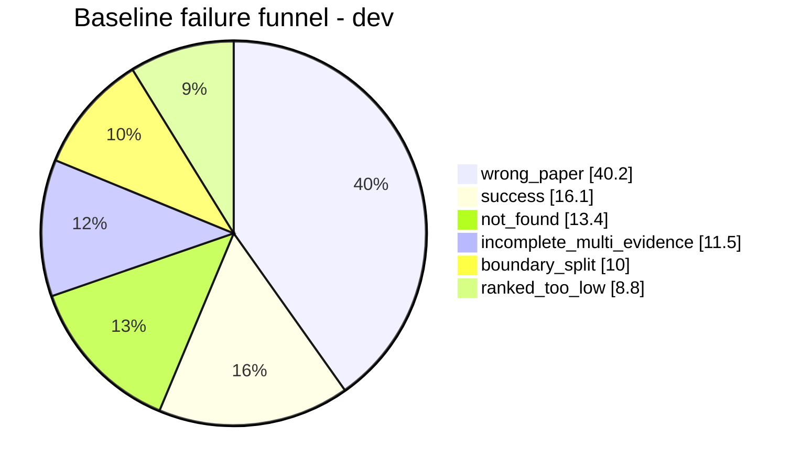

# Step 3: Diagnosis - Failure Analysis

## The Central Question
> **If a response is wrong, did the system fail to find the evidence, choose the right evidence, or use the evidence it already had?**

The failure funnel assigns each dev question **one primary label** using a priority-ordered decision tree.

## The 6 Failure Labels (Priority Order)

| Priority | Label | Meaning |
|---|---|---|
| 1 | `wrong_paper` | No top-10 chunk is from the target paper |
| 2 | `incomplete_multi_evidence` | Some but not all gold paragraphs covered |
| 3 | `boundary_split` | Right paper, but chunk edges cut the paragraph (<80%) |
| 4 | `ranked_too_low` | Gold covered in top-50 but not top-10 |
| 5 | `not_found` | Target paper present, gold not even in top-50 |
| — | `success` | All gold paragraphs covered in top-10 |

## Baseline Failure Funnel (Dev, 261 questions)



### Headroom Diagnostics

Two diagnostics bound what any optimization *could* achieve:

```text
paper-confusion diagnostic : union R@10 0.212 -> 0.651
   (restrict search to the target paper; DIAGNOSTIC ONLY, never submitted)
chunking ceiling          : 1.00 union / 0.69 single  (a perfect ranker)
```

**Key takeaway**: The ceiling is high (1.00), so the *chunks* are fine. The loss is **retrieval** — mostly picking the wrong paper. This directly motivated A (title/heading context) and B (BM25 for distinctive terms).

### 10-Question Failure Table

Each case has a label, question text, gold passage, top-1 retrieved chunk, likely cause, and proposed fix linked to optimizations A, B, C.

#### Example Cases:

**f651cd14 | wrong_paper**
- Question: "what evaluation metrics did they use?"
- Target paper: "Improving Neural Text Simplification Model with Simplified Corpora"
- Gold: paragraph s5:p2 (Evaluation section)
- Top-1: "Handling Divergent Reference Texts when Evaluating Table-to-Text Gener" (wrong paper)
- Likely cause: Short generic question ("evaluation metrics") ranks a thematically similar paper
- Proposed fix: BM25 (B) + title context in embeddings (A)

**9b7655d3 | boundary_split**
- Question: "Which toolkits do they use?"
- Target paper: "Performance Comparison of Crowdworkers and NLP Tools..."
- Gold: paragraph s1:p2 (NLP Toolkits)
- Top-1: "NeuronBlocks: Building Your NLP DNN Models Like Playing Lego" (wrong paragraph boundary)
- Likely cause: Fixed 1,000-char window cuts the "NLP Toolkits" section
- Proposed fix: Structure-aware chunking (A) that snaps edges to paragraph boundaries

**051df74d | ranked_too_low**
- Question: "How did they obtain the OSG dataset?"
- Target paper: "Affective Behaviour Analysis of On-line User Interactions..."
- Gold: paragraph s5:p0 (Datasets)
- Top-1: "RUN through the Streets: A New Dataset and Baseline Models for Realist" (ranked outside top-10)
- Likely cause: Dense score favors a generically similar paper; exact passage is ranked 11+
- Proposed fix: Cross-encoder reranking top-30 (C)

**bc31a3d2 | not_found**
- Question: "What BERT model do they test?"
- Target paper: "Symmetric Regularization based BERT for Pair-wise Semantic Reasoning"
- Gold: paragraph s6:p0 (Experiment Settings, "BERTbase")
- Top-1: "Pretraining-Based Natural Language Generation for Text Summarization" (target paper not in top-50)
- Likely cause: "BERTbase" only in gold paragraph; dense embedding matches many papers
- Proposed fix: BM25 lexical retrieval (B) on rare exact token "BERTbase"

**c00ce1e3 | wrong_paper**
- Question: "What activation function do they use in their model?"
- Target paper: "FacTweet: Profiling Fake News Twitter Accounts"
- Gold: paragraph s2:p11 ( Experiments and Results)
- Top-1: "Natural Language Generation for Spoken Dialogue System using RNN Encoder" (wrong paper)
- Likely cause: Generic model-architecture query; dense embedding dominated by shared "model" vocabulary
- Proposed fix: Hybrid dense + BM25 (B) + title context in embeddings (A)

**ee417fea | not_found**
- Question: "Do they use off-the-shelf NLP systems to build their assitant?"
- Target paper: "Multipurpose Intelligent Process Automation via Conversational Assistant"
- Gold: paragraph s4:p13 (Model ::: Dialogue Modules, RegEx, Elasticsearch)
- Top-1: "Multipurpose Intelligent Process Automation via Conversational Assistant" (correct paper, but rare tokens not surfaced)
- Likely cause: Rare tokens ("RegEx", "Elasticsearch") only in gold paragraph; dense retrieval doesn't surface them in top-50
- Proposed fix: BM25 lexical retrieval (B) on rare tokens

---
